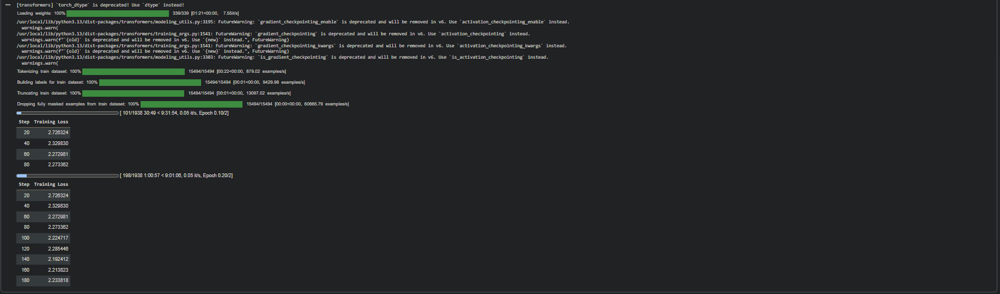

# Negotiation Coach LLM — Fine-tuning a Domain-Specific Qwen2.5-3B

Fine-tuned **Qwen2.5-3B-Instruct** with LoRA on a custom negotiation Q&A dataset
(Never Split the Difference–style questions), then deployed it as a fully local
CPU-only chat model via GGUF + Ollama.


## v2: Qwen2.5-7B QLoRA on Colab free tier (latest)

A 7B QLoRA version was taken to live training on Colab's free T4 — full
15,811-record dataset validated, training running, loss falling from **2.73 to
2.24** by epoch 0.2 — and paused only because a 2-epoch run needs ~10 GPU-hours,
past the free-session window. All T4/TRL fixes are baked into a ready-to-resume
notebook.



Full engineering log: [`v2-colab-qlora/TRAINING-LOG.md`](v2-colab-qlora/TRAINING-LOG.md)

## What this project does (end to end)

| Stage | Tool | Output |
|---|---|---|
| Data prep | JSONL, `{"user", "assistant"}` chat format | 5,744 examples (4,568 train / 508 val / 668 test) |
| Training | Google Colab T4, transformers + trl + peft | LoRA adapter (r=16, α=32, 4-bit QLoRA) |
| Merge | transformers + peft on CPU | merged fp16 model |
| Convert | llama.cpp `convert_hf_to_gguf.py` | f16 GGUF (~6.2 GB) |
| Quantize | llama.cpp `llama-quantize` | q4_K_M GGUF (~1.9 GB) |
| Deploy | Ollama `Modelfile` (custom system prompt + template) | `ollama run muzakere` |

## Why LoRA (and not full fine-tuning)

Full fine-tuning a 3B model on a 5.7k-example set is wasteful and overfit-prone.
LoRA adapts ~0.24% of the parameters — cheap, portable (adapter = 14 MB), and the
adapter stacks onto the public base model.

## Honest results / limitations

Measured on a CPU-only machine (i5-13420H, 16 GB RAM):

- **v1 (1 epoch, lr 2e-4, 286 steps):** the model picked up the domain vocabulary
  but the light training dose hurt its instruction-following outside its domain —
  known trade-off of narrow single-epoch SFT.
- **v2 (7B QLoRA, live-trained on Colab T4):** full 15,811-record dataset,
  2 epochs, r=16 / α=32 — see the v2 section above. Training confirmed working
  (loss 2.73 → 2.24 by epoch 0.2); paused at free-tier session limits.

The point of publishing v1 is the pipeline, not the model's IQ: every stage
(data → train → merge → quantize → deploy) is scripted and reproducible.

## Repo layout

- `notebook/` — Colab training notebook
- `scripts/merge_lora.py` — adapter → merged fp16 model
- `modelfile/Modelfile` — Ollama model definition (system prompt + chat template)
- `data/sample_100.jsonl` — 100-example sample of the dataset

## Usage

```
ollama create muzakere -f modelfile/Modelfile
ollama run muzakere
```

## Author

Taner Berk Bayirli — built end-to-end with an AI agent pair-programming setup (dataset design, training runs, deployment pipeline).
