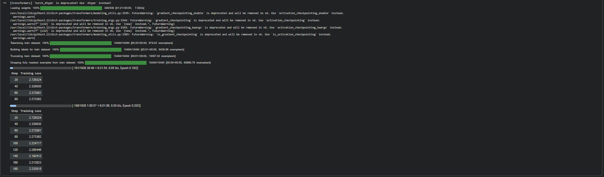

# Qwen2.5-7B QLoRA — v2 Training Attempt (Colab Free Tier)

**Status: engineering complete, training compute-limited.** The full pipeline — data
validation, QLoRA training setup, and live training — runs on Colab's free T4 GPU.

## What was done

1. **Dataset validated end to end** (`data_full.jsonl`, 15,811 records):
   - schema check: every line is exactly `{"user": str, "assistant": str}`
   - 0 empty fields, 0 duplicate user questions
   - max sample length ~663 chars (≈170 tokens) → `max_length=1024` covers everything
2. **QLoRA training pipeline built and run live** on Colab T4:
   - 4-bit NF4 quantization + double quant, `prepare_model_for_kbit_training`
   - LoRA r=16 / alpha=32 on all linear layers
   - 15,494 train samples after the 2% eval split
3. **Training confirmed working:** loss fell from **2.726 → ~2.22** through
   epoch 0.2/2, with every preprocessing stage (tokenizing, label building,
   truncation) completing on all 15,494 samples (see screenshot).
4. **Four real T4/TRL issues found and fixed along the way** (fixes are baked
   into the notebook so it runs out of the box):
   - TRL latest removed `warmup_ratio` from `SFTConfig`
   - T4 (compute capability 7.5) rejects `bfloat16` compute dtype → switched to `float16`
   - leftover BF16 gradients crashed the AMP grad scaler → AMP disabled (`fp16=False`;
     4-bit training computes in fp16 internally anyway)
   - `prepare_model_for_kbit_training` upcasts embeddings to fp32 (~2.03 GiB),
     pushing peak memory past the T4's 14.6 GiB → large fp32 tensors are cast
     back to fp16 after preparation

## Why it was stopped

Colab free tier provides a single T4 with 14.6 GiB VRAM and limited session
length. A 2-epoch run of 7B on 15.8k samples takes ~10 hours at the measured
step rate. As a student without paid GPU credits, I paused the run rather than
risk a mid-epoch disconnect. The 3B model in the main pipeline is the
compute-appropriate target on free hardware; this folder preserves the full 7B
attempt so it can be resumed on any GPU with >16 GB VRAM with zero code changes.

## Evidence

## Files

- `qwen25_7b_colab_qlora.ipynb` — the complete Colab notebook (all fixes applied)
- `data_full.jsonl` — the full 15,811-record training dataset (`{"user", "assistant"}` pairs)
- `screenshots/` — live evidence of the run

## How to resume

Run the notebook on any GPU with >16 GB VRAM. The notebook downloads the data,
validates it, trains 2 epochs of QLoRA, and exports the LoRA adapter + tokenizer.
