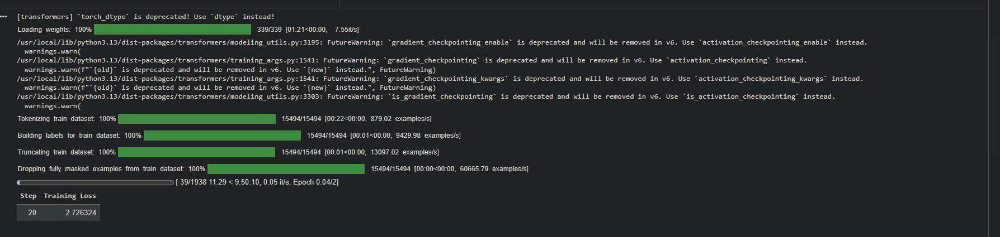
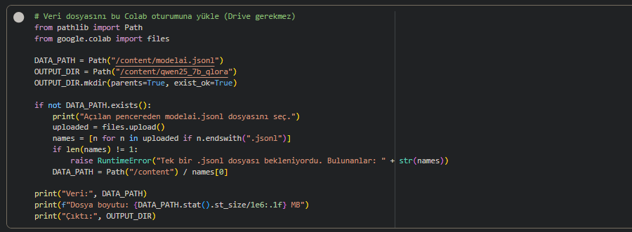
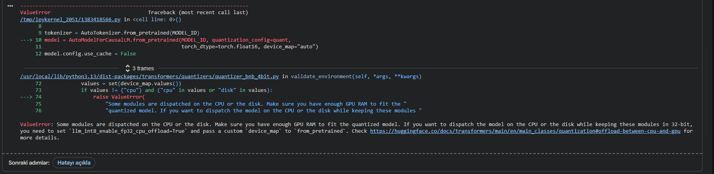
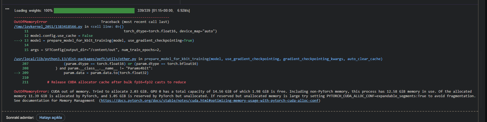
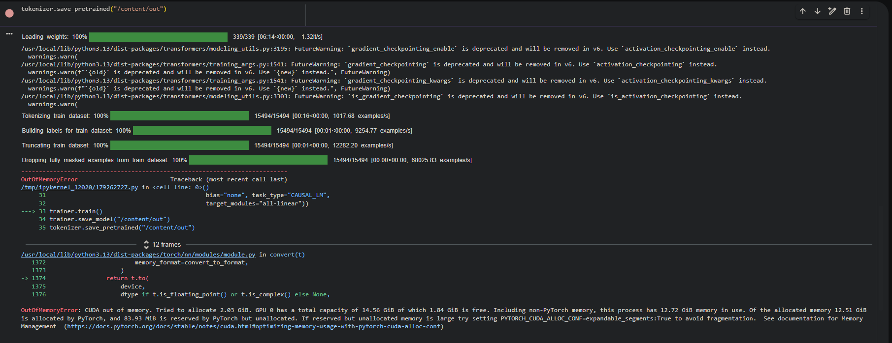

# Qwen2.5-7B QLoRA — v2 Training Attempt (Colab Free Tier)

**Status: engineering complete, training compute-limited.** The full pipeline — data
validation, QLoRA training setup, and the first live training steps — ran successfully
on Colab's free T4 GPU. The run was stopped only because a 2-epoch run on 7B takes
~10 hours on the free tier, which exceeds the free-session window. All fixes required
to run it yourself are already baked into the notebook in this folder.

## What was done

1. **Dataset validated end to end** (`data_full.jsonl`, 15,811 records):
   - schema check: every line is exactly `{"user": str, "assistant": str}`
   - 0 empty fields, 0 duplicate user questions
   - max sample length ~663 chars (≈170 tokens) → `max_length=1024` covers everything
2. **QLoRA training pipeline built and debugged live** on Colab T4:
   - 4-bit NF4 quantization + double quant, `prepare_model_for_kbit_training`
   - LoRA r=16 / alpha=32 on all linear layers
   - dataset: 15,494 train samples after 2% eval split
   - training started and produced loss **2.726 at step 20** (see screenshots)
3. **Four real T4/v5-stack issues found and fixed** (all documented with screenshots below):
   - TRL latest removed `warmup_ratio` from `SFTConfig`
   - T4 (compute capability 7.5) rejects `bfloat16` compute dtype → switched to `float16`
   - leftover BF16 gradients crashed the AMP grad scaler → AMP disabled (`fp16=False`;
     4-bit training computes in fp16 internally anyway)
   - `prepare_model_for_kbit_training` upcasts embeddings to fp32 (~2.03 GiB on this
     model), which pushed peak memory over the T4's 14.6 GiB → big fp32 tensors are
     cast back to fp16 after preparation

## Why it was stopped

Colab free tier provides a single T4 with 14.6 GiB VRAM and sessions of at most a few
hours. A 2-epoch run of 7B on 15.8k samples took ~10 hours at the measured step rate
(0.05 it/s, loss decreasing normally). As a student without paid GPU credits, I paused
the run rather than risk a mid-epoch disconnect. The 3B model in the main pipeline is
the compute-appropriate target on free hardware; this folder preserves the full 7B
attempt so it can be resumed on any GPU with >16 GB VRAM (e.g. Colab A100, Kaggle T4×2,
or any rented GPU) with zero code changes.

## Evidence

| | |
|---|---|
| Training running, loss 2.726 @ step 20 (epoch 0.04/2) |  |
| Final training cell (float16 / AMP-off / fp32-cast-back) |  |
| T4 rejects bfloat16 ops |  |
| T4 14.6 GiB budget under QLoRA load |  |
| OOM from the fp32 embedding upcast (~2.03 GiB) |  |

## Files

- `qwen25_7b_colab_qlora.ipynb` — the complete Colab notebook (all fixes applied)
- `data_full.jsonl` — the full 15,811-record training dataset (`{"user", "assistant"}` pairs)
- `screenshots/` — live evidence of the run and of each failure/success step

## How to resume

Run the notebook on any GPU with >16 GB VRAM. The notebook downloads the data,
validates it, trains 2 epochs of QLoRA, and exports the LoRA adapter + tokenizer.
